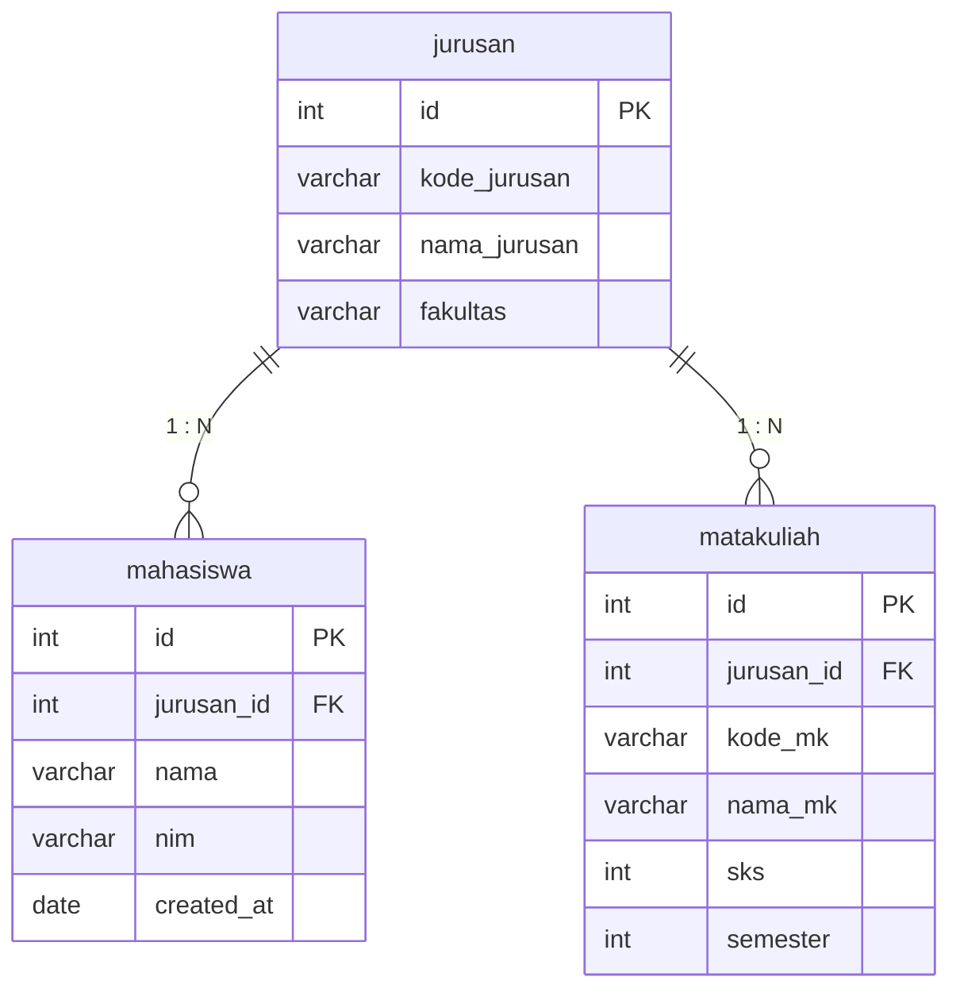
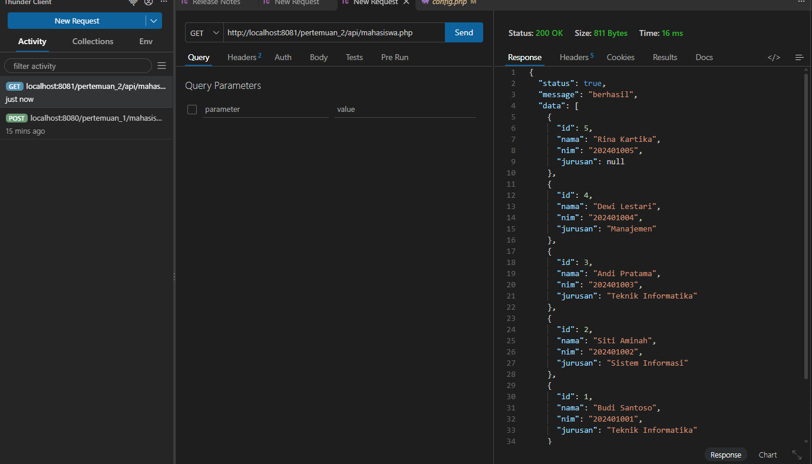

# PDCS Pertemuan 2 — PHP-MySQL, ERD & Response Helper

Tugas Pertemuan 2 mata kuliah **Pemrograman Database Client Server (IT027)**.

REST API data mahasiswa yang mengambil data dari database MySQL, memakai helper response JSON yang seragam, dan diuji dengan **Thunder Client** di VS Code.

## Struktur project

```
pertemuan_2
├── api
│   └── mahasiswa.php      # endpoint GET mahasiswa + LEFT JOIN jurusan
├── config.php             # koneksi MySQL + error HTTP 500
├── helpers
│   └── response.php       # fungsi sendResponse()
├── database
│   └── pdcs.sql           # 3 tabel + foreign key + data contoh
├── screenshots            # hasil testing Thunder Client
└── start-server.bat       # server PHP di localhost:8080
```

## ERD



- `mahasiswa.jurusan_id` → `jurusan.id` (ON DELETE SET NULL)
- `matakuliah.jurusan_id` → `jurusan.id` (ON DELETE CASCADE)

## Cara menjalankan

1. Jalankan MySQL (XAMPP/Laragon), buka phpMyAdmin.
2. Tab **Import** → pilih `database/pdcs.sql` → **Go**. Database `pdcs` dibuat lengkap dengan 3 tabel dan foreign key.
3. Sesuaikan `config.php` kalau user/password MySQL berbeda (default `root` tanpa password).
4. Jalankan `start-server.bat`, atau taruh folder ini di `htdocs` / `www`.

## Endpoint

| Method | URL | Status |
|---|---|---|
| GET | `http://localhost:8080/pertemuan_2/api/mahasiswa.php` | `200 OK` |

Kalau memakai XAMPP/Laragon: `http://localhost/pertemuan_2/api/mahasiswa.php`.

## Format response

Semua response memakai `sendResponse($status, $message, $data, $httpCode)`:

| Field | Tipe | Keterangan |
|---|---|---|
| `status` | boolean | berhasil atau tidak |
| `message` | string | pesan dari server |
| `data` | array / object / null | data hasil query |

GET berhasil (`200 OK`):

```json
{
    "status": true,
    "message": "berhasil",
    "data": [
        { "id": 5, "nama": "Rina Kartika", "nim": "202401005", "jurusan": null },
        { "id": 4, "nama": "Dewi Lestari", "nim": "202401004", "jurusan": "Manajemen" },
        { "id": 3, "nama": "Andi Pratama", "nim": "202401003", "jurusan": "Teknik Informatika" },
        { "id": 2, "nama": "Siti Aminah", "nim": "202401002", "jurusan": "Sistem Informasi" },
        { "id": 1, "nama": "Budi Santoso", "nim": "202401001", "jurusan": "Teknik Informatika" }
    ]
}
```

Mahasiswa tanpa jurusan tetap muncul (`"jurusan": null`) karena query memakai `LEFT JOIN`.

Koneksi database gagal (`500 Internal Server Error`):

```json
{
    "status": false,
    "message": "Koneksi database gagal",
    "data": null
}
```

## Pengujian di Thunder Client

1. Buka Thunder Client → **New Request**.
2. Method **GET**, URL `http://localhost:8080/pertemuan_2/api/mahasiswa.php`.
3. Klik **Send** → `Status: 200 OK`.

## Hasil testing Thunder Client

GET `/pertemuan_2/api/mahasiswa.php` → `200 OK`


